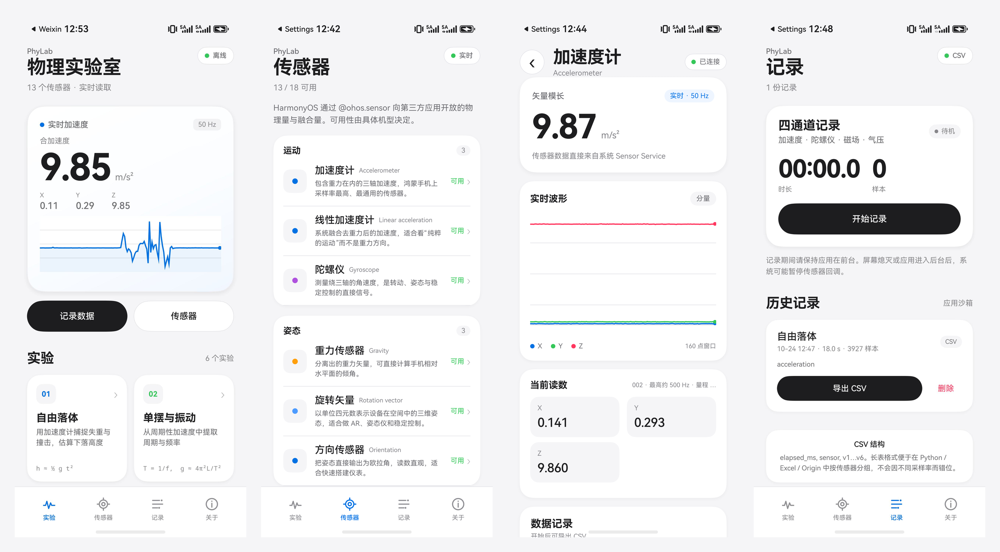

# PhyLab · 鸿蒙物理实验室

> 把 HarmonyOS 手机变成一台随身传感器实验台。

PhyLab 是一个为 **HarmonyOS 7（API 26）** 编写的离线传感器物理实验应用。它直接读取手机中的加速度计、陀螺仪、磁力计、重力、旋转矢量、方向、环境光、接近光等传感器，提供实时波形、6 个物理实验、四通道记录和 CSV 导出。所有计算和存储都在设备本地完成。



## 特性

- **18 类传感器目录**：加速度、线性加速度、陀螺仪、磁力计、重力、旋转矢量、方向、气压、环境光、接近光、温度、湿度、计步、心率、未校准加速度/陀螺、霍尔、佩戴检测。
- **实时波形**：ArkUI Canvas 多序列曲线，支持分量/模长显示，自适应坐标轴。
- **6 个物理实验**：
  - 自由落体：失重检测、冲击峰值、下落高度估算
  - 单摆与振动：过零检测、周期/频率
  - 转动实验室：角速度、rpm、累计转角
  - 磁场探针：总场强、基线偏移、铁磁判断
  - 气压高度计：相对高度、垂直速度
  - 电子水平仪：总倾角、双轴坡度
- **四通道记录**：加速度、陀螺仪、磁场、气压同时采集。
- **CSV 导出**：长表格式 `elapsed_ms, sensor, v1..v6`，通过系统文件选择器保存，可直接用 Excel、Python、Origin 分析。
- **完全离线**：不申请 `ohos.permission.INTERNET`；无账号、无广告、无第三方统计 SDK。
- **传感器可用性**：按设备实际开放的传感器显示“可用/不支持”，不伪造数据。

## 已测试环境

| 项目 | 结果 |
| --- | --- |
| 设备 | HUAWEI Pura 70 Pro+（HBN-AL80） |
| 系统 | HarmonyOS 7.0.0.109 / API 26 |
| 构建 | DevEco Studio 26.0.0.851 + HarmonyOS SDK 26.0.0.105 |
| 安装 | `hdc install` 成功 |
| 传感器 | 13 / 18 类可用；该机气压计未向第三方开放 |
| 实时加速度 | 约 9.85 m/s²，X/Y/Z 同步刷新 |
| 实验记录 | 自由落体 18.0 s / 3927 样本 |
| CSV 导出 | 3933 行、190,203 字节，导出到 Download 成功 |

> 不同华为机型开放的传感器不同；应用会读取 `sensor.getSensorListSync()`，按实际能力展示。

## 快速开始

### 环境

- DevEco Studio 26.0.0 或更新版本
- HarmonyOS SDK API 26
- HarmonyOS 7 手机或平板（用于真机运行）

### 用 DevEco Studio 运行

1. 用 DevEco Studio 打开本仓库根目录。
2. 等待 Sync 完成；SDK 选择 API 26。
3. 手机开启开发者模式和 USB 调试，连接电脑。
4. `File → Project Structure → Signing Configs`，勾选 **Automatically generate signature**，登录华为开发者账号。
5. 点击 **Run 'entry'**。

> 仓库不包含任何证书、Profile 或密码。DevEco 自动签名会在本地生成签名材料，**不要提交到 Git**。

### 命令行构建

以 DevEco Studio 安装目录为 `$DEVECO_HOME`：

```powershell
$env:JAVA_HOME = "$DEVECO_HOME\jbr"
$env:Path = "$DEVECO_HOME\tools\node;$DEVECO_HOME\jbr\bin;$env:Path"
$env:DEVECO_SDK_HOME = "$DEVECO_HOME\sdk"

& "$DEVECO_HOME\tools\node\node.exe" `
  "$DEVECO_HOME\tools\hvigor\bin\hvigorw.js" `
  --mode module -p product=default -p module=entry@default assembleHap --no-daemon
```

产物：

```text
entry/build/default/outputs/default/entry-default-signed.hap
```

## 项目结构

```text
PhyLab/
├── AppScope/                         # 应用级配置与图标
├── entry/src/main/
│   ├── ets/
│   │   ├── entryability/EntryAbility.ets
│   │   ├── pages/
│   │   │   ├── Index.ets             # 首页 / 传感器 / 记录 / 关于
│   │   │   ├── SensorDetail.ets      # 传感器详情与实时波形
│   │   │   └── ExperimentDetail.ets  # 6 个实验运行时
│   │   ├── components/MultiChart.ets # Canvas 多序列波形
│   │   ├── model/Catalog.ets         # 传感器与实验元数据
│   │   ├── model/Routes.ets
│   │   └── services/
│   │       ├── SensorHub.ets         # @ohos.sensor 封装
│   │       └── Recorder.ets          # 记录、CSV、历史、导出
│   ├── resources/
│   └── module.json5
├── docs/                             # 传感器说明、验证报告、运行说明
├── design/                           # UI 预览与真机合成图
├── tests/smoke_test.py               # 公式与 CSV 结构冒烟测试
├── build-profile.json5
├── hvigorfile.ts
├── oh-package.json5
└── package.json
```

## 隐私

- 不申请网络权限，不上传任何数据。
- 传感器数据、实验记录和 CSV 均在设备本地处理；导出位置由用户通过系统文件选择器决定。
- 不收集账号、手机号、通讯录、照片、精确位置等信息。
- 详见 [隐私政策](docs/PRIVACY.md) 与 [用户协议](docs/TERMS.md)。

## 已知限制

- 传感器是否开放取决于机型和系统权限；例如部分机型不向第三方开放气压计、心率、环境温度或湿度。
- 后台或锁屏时 HarmonyOS 可能暂停传感器回调；记录时请保持应用在前台。
- 手机 MEMS 传感器适合教学演示、趋势观察和 DIY 实验，不建议替代专业计量仪器。
- 当前工程面向 HarmonyOS 7 / API 26；更低 API 版本需要自行适配。

## 版本

当前版本：**1.0.0**

完整的版本特性见 [CHANGELOG.md](CHANGELOG.md) 和 GitHub Releases。

## 贡献

欢迎提交 Issue 或 Pull Request。请先阅读 [CONTRIBUTING.md](CONTRIBUTING.md)。

## 许可

本项目以 [Apache License 2.0](LICENSE) 发布。

phyphox 是 RWTH Aachen University 的商标；本项目是独立实现，不包含 phyphox 的代码或资源。
